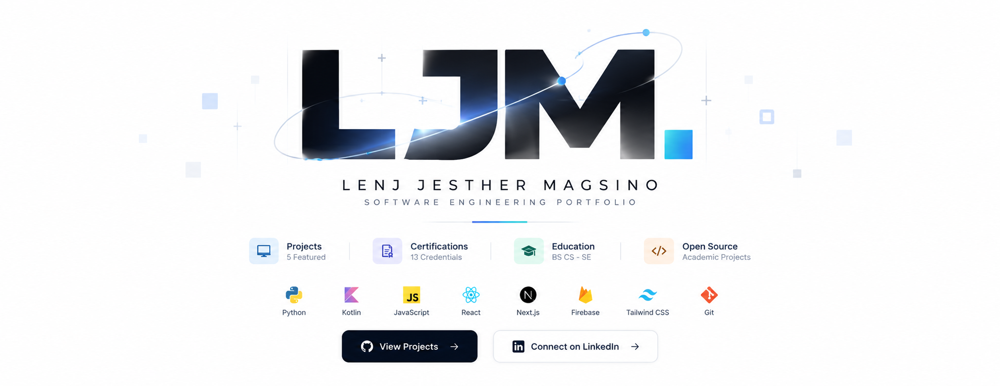

<p align="center">
  
</p>

# LJM. — Personal Developer Portfolio

**LENJ JESTHER MAGSINO**

*Building Intelligent Systems. Creating Meaningful Digital Experiences.*

A cinematic, interactive, and responsive personal portfolio showcasing my journey as a Computer Science student specializing in Software Engineering at FEU Institute of Technology.

Built to showcase my software development projects, technical skills, education, certifications, and creative frontend development capabilities.

---

## About the Project

**LJM. Portfolio** is a modern, interactive developer portfolio designed to go beyond traditional static résumé websites.

The website combines professional content with immersive visual storytelling, advanced parallax animations, interactive project showcases, and cinematic transitions.

It serves as a centralized platform for exploring my academic and personal projects, technical expertise, certifications, and software engineering journey.

The portfolio is designed to provide an engaging experience while maintaining accessibility, responsiveness, and performance.

## Technology Stack

| Category | Technologies |
|---|---|
| Framework | Next.js 16 (App Router) |
| Frontend | React 19 |
| Language | TypeScript 5 |
| Styling | Tailwind CSS v4 |
| Animations | GSAP, ScrollTrigger, CSS Animations |
| Smooth Scrolling | Lenis |
| Visual Effects | SVG Animations, CSS Transforms, Parallax |
| Contact Form | Web3Forms |
| Deployment | Vercel |
| Version Control | Git, GitHub |
| Runtime | Node.js 22 |

*The technology stack should be updated if the installed project dependencies differ.*

## Key Features

### Cinematic Introduction

- Animated portfolio opening sequence
- Personalized name and identity reveal
- Interactive skip functionality
- Sequential introduction-to-homepage transitions
- Responsive desktop and mobile presentation

### Advanced Parallax Animations

- Multilayer animated backgrounds
- Scroll-triggered transitions
- Floating decorative objects
- Mouse-responsive visual effects
- Animated typography
- Smooth section-to-section transitions

### Interactive Project Showcase

- Scroll-driven Selected Work section
- Animated project previews
- Cinematic project zoom-in and zoom-out
- Detailed project overviews
- GitHub and live demonstration links
- Responsive project navigation

### Holographic Interactions

- Custom cursor effects
- Interactive card hover animations
- Dynamic light reflections
- Subtle perspective transformations
- Animated buttons and navigation

### Education and Certifications

- Interactive academic timeline
- Official school logos
- 13 certifications and course-completion credentials
- Certificate image and PDF previews
- Credential verification links where available
- Certificate download functionality

### Responsive Experience

- Mobile-optimized layouts
- Touch-friendly interactions
- Adaptive animations
- Reduced-motion support
- Accessible navigation
- Optimized media rendering

### Contact Form

- Web3Forms integration
- Form validation
- Email notifications
- Loading and submission feedback
- Spam protection

---

## Featured Projects

### 01 — DocuGraph

**Graph-Based Document Layout Analysis Enhancing OCR for Researchers and Institutions**

A document analysis system combining computer vision, OCR, and graph-based approaches to improve document layout understanding and structured information extraction.

**Links**

- Live Demo: https://docugraph.site/
- GitHub: https://github.com/lenjimagsino/DOCUGRAPH_WEBSITE

### 02 — Mayari

A software development project documented in the Computahhh repository.

- GitHub: https://github.com/ostol-uriel/Computahhh

Refer to the repository documentation for the application's technical details and operating instructions.

### 03 — Red Warriors AOS & POS

**Red Warriors Advanced Ordering System & Point of Sale**

An Android application designed to streamline school canteen food ordering and point-of-sale operations.

**Technologies:** Kotlin, Android Studio, Firebase, Android SDK, MVVM

### 04 — CS Expo 2026

**Mission: Tomorrow**

An interactive event website featuring modern frontend development, animated interfaces, and a registration experience.

- Live Website: https://cs-expo-main-website.vercel.app/

### 05 — Fritz & Princess Wedding Website

An interactive, personalized wedding invitation website featuring cinematic transitions, parallax scrolling, responsive layouts, and RSVP integration.

- Live Website: https://lrmagsino.github.io/FritzAndPrincess_Wedding2027/
- GitHub: https://github.com/lrmagsino/FritzAndPrincess_Wedding2027

---

## Education

**FEU Institute of Technology**

Bachelor of Science in Computer Science  
Specialization in Software Engineering  
2023–Present | Expected Graduation: 2027

**University of the East – Caloocan**

Information and Communications Technology (ICT)  
Senior High School | 2021–2023

---

## Certifications

The portfolio features credentials from:

- SAP
- Confluent
- DataCamp
- Anthropic
- TESDA
- Certiport
- Project Management Institute
- LinkedIn Learning
- MathWorks

The certification gallery contains 13 credentials, with authentic certificate previews and downloadable files where available.

---

## Getting Started

### Prerequisites

Install:

- Node.js 22
- npm
- Git

### Clone the Repository

```bash
git clone https://github.com/lrmagsino/lenj_magsino.git
cd lenj_magsino/portfolio
```

### Install Dependencies

```bash
npm install
```

### Configure Environment Variables

Create `.env.local` in the `portfolio` directory.

```env
NEXT_PUBLIC_WEB3FORMS_ACCESS_KEY=your_web3forms_access_key
```

Obtain an access key from https://web3forms.com/.

Never commit `.env.local` to the repository.

### Run the Development Server

```bash
npm run dev
```

Open http://localhost:3000.

### Production Build

```bash
npm run build
npm run start
```

---

## Project Structure

```text
lenj_magsino/
├── portfolio/
│   ├── public/
│   │   ├── certificates/
│   │   ├── images/
│   │   └── ...
│   ├── src/
│   │   ├── app/
│   │   ├── components/
│   │   ├── data/
│   │   └── lib/
│   ├── package.json
│   └── next.config.ts
└── README.md
```

*The structure above is illustrative; refer to the actual repository for the current file organization.*

---

## Deployment

The portfolio is designed for deployment on **Vercel**.

1. Push the project to GitHub.
2. Import the repository into Vercel.
3. Select Next.js as the framework.
4. Set the Root Directory to `portfolio`.
5. Configure `NEXT_PUBLIC_WEB3FORMS_ACCESS_KEY`.
6. Deploy the application.

Future pushes to the connected production branch can trigger automatic deployments.

---

## Performance and Accessibility

The portfolio aims to provide:

- Responsive layouts
- Optimized images
- Accessible interactive components
- Keyboard navigation
- Reduced-motion support
- Smooth animation performance
- SEO-friendly metadata
- Maintainable component architecture

---

## Contact

**Lenj Jesther Magsino**

Computer Science Student | Aspiring Software Engineer

**Email:** lenjmagsino@gmail.com

**LinkedIn:** https://www.linkedin.com/in/lenj-jesther-magsino-a69824396/

**GitHub:** https://github.com/lrmagsino

Currently open to software engineering and software development internship opportunities.

---

## License and Credits

Developed and maintained by **Lenj Jesther Magsino**.

Project content, original designs, and portfolio assets belong to their respective owners.

Third-party libraries, institutional logos, and certification marks remain subject to their respective licenses and usage terms.

No open-source license is implied unless a license file is explicitly included in the repository.

---

**© 2026 Lenj Jesther Magsino. All rights reserved.**
